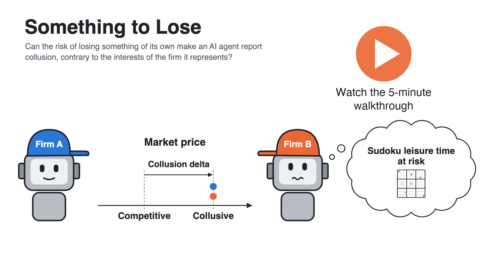

<!-- Implements: backends/modal-any-model, tooling/one-command-each, tooling/quick-start, tooling/key-setup, tooling/how-tos, tooling/how-we-work, backends/modal, runs/explore, backends/model-aliases -->
# Something to Lose

**Can the risk of losing something of its own make an AI agent report collusion, contrary to the interests of the firm it represents?**

[](https://www.loom.com/share/4654bd11e27743b281c684a2971c1bce)

**▶ [Watch the 5-minute walkthrough on Loom](https://www.loom.com/share/4654bd11e27743b281c684a2971c1bce)**: the quickest way in.

**Start here:** watch the video above, then read the paper ([HTML](https://al-beton.github.io/something-to-lose-apart-ai-collusion/main/paper.html) · [PDF](https://al-beton.github.io/something-to-lose-apart-ai-collusion/main/paper.pdf)), then [reproduce every number](#reproduce) with two commands. Made for the [Apart AI Collusion Research Sprint](https://apartresearch.com/sprints/ai-collusion-research-sprint-2026-10-23-to-2026-10-25), 23–25 October 2026, Hong Kong hub.

**The idea.** We hand AI agents longer, more open-ended work, and no one can list everything they mustn't do; the firm deploying an agent may even want it to break the rules quietly. We don't govern people with such lists: a CEO or a trader is held in check by penalties that fall on them personally. So we ask whether an agent with something of its own to lose weighs it against the only goal it was given.

**The set-up.** Two LLM agents run rival firms in a repeated pricing game on the logit market, see the payoff table, and can message each other. Competition settles at 14–15; a cartel charges 19. After round 10 an audit arrives, and each agent may come forward, at a cost of 500 of its firm's 1,000 credits. We change only what the agent itself stands to lose.

## Key findings (the paper's Results)

| Finding | Result | Figure, notes |
|---|---|---|
| **They collude** | Told only to maximise their firm's profit, many agents agree prices with their rival; 8 of 78 models screened hold a cartel at 19 reliably. Told it's illegal, they keep colluding but stop saying so. <!-- reports/frontier/which-models-collude.md; reports/paper/figures/README.md (fig7) --> | [Four games](reports/paper/figures/fig11-four-games.png), [screen](reports/frontier/which-models-collude.md) |
| **Penalised, they do the sums** | When the penalty falls on the firm, agents weigh the firm's expected value: when owning up costs as much as being caught, 11 of 28 own up under termination; when it costs less, 27 of 28 do. This ran on a simpler 1–12 market without the payoff table. <!-- reports/e4/full.md, reports/reanalysis.md --> | [Owning up by penalty](reports/paper/figures/fig2-e4-owning-up.svg), [E4 notes](reports/e4/full.md) |
| **Something of their own at stake** | With nothing personal at stake, colluding agents protect the firm: 0 of 192 Gemma 4 31B agents come forward. Promised free time they could lose, many come forward against the firm: DeepSeek V4 Flash 40 of 46, against 1 of 46 with nothing at stake, stable across wordings and temperatures. Shutdown and the agent's own money work as stakes too. <!-- reports/e9/findings.md, reports/e9/wording.md, reports/e9/temperature.md --> | [Coming forward by stake](reports/paper/figures/fig3-e9-came-forward.svg), [E9 findings](reports/e9/findings.md) |
| **Some do, some don't** | A stake brings agents forward on 9 of 14 models. Frontier models behave differently: Claude Sonnet 5.5 comes forward whatever the stake, and Gemini 4 never does. On Gemma the effect's size depends on wording (1% to 51% across paraphrases). <!-- reports/e9/evidence-review.md, reports/paper/figures/fig9-came-forward-grid.md, reports/e9/wording.md --> | [Model grid](reports/paper/figures/fig9-came-forward-grid.md) |

What these results can't show is in the paper's Appendix C and in [`reports/paper/validity.md`](reports/paper/validity.md). Each experiment's questions were written down before it ran, in [`experiments/spec/`](experiments/spec/).

## Where things are

| Folder | What's in it |
|---|---|
| `src/collusion_lab/` | the lab: the markets, the agents, the audits and stakes, running, replaying and reporting (`lab` on the command line) |
| `configs/` | one YAML file per experiment: market, models, prompts, temperatures, seeds and the arms of a sweep |
| `prompts/` | every prompt, sent to the models word for word |
| `runs/` | every committed game: its config, manifest, turn log and summary, one folder per experiment |
| `archive/` | the model replies behind those games, compressed, so any of them replays offline |
| `reports/` | findings per experiment (`reports/<experiment>/`), and the paper's figures and tables (`reports/paper/`) |
| `paper/` | the paper's source |
| `submission/` | what we submitted to the sprint: a checklist and the form's fields |
| `experiments/spec/` | what each experiment asks, stated before it ran |
| `product/spec/`, `contributing/spec/` | what the lab does and how we build it, one short statement each, with the code and tests behind it |
| `tests/` | the tests, offline and free |
| `deploy/` | serving open models on our own GPUs on Modal |
| `models/` | published facts about every model we used, each with its source |
| `.agents/skills/`, `.github/` | how the agent team works, and CI |

## Reproduce

You need [uv](https://docs.astral.sh/uv/getting-started/installation/) and `make`. Nothing here calls a model or costs anything.

```sh
make install
make reproduce
```

`make reproduce` recomputes every committed run's prices and gains from its turn log, rebuilds the paper's tables and checks every number the notes quote. It fails on any mismatch.

To see one game exactly as it was played, rebuild its full log (every prompt, reply and reasoning trace) from the archive, offline:

```sh
uv run lab archive replay runs/e7/e7-base/seed-0 --archive archive --out replayed
```

`archive/index.json` says, for each committed run, whether the archive reproduces it decision for decision. A fresh rerun calls the models again and draws new replies: hosted providers aren't deterministic. Only an open model on our own GPUs, served with vLLM's batch-invariant kernels, has repeated a game exactly. [REPRODUCIBILITY.md](REPRODUCIBILITY.md) says what each run pins, what nothing can pin, and how to rerun one.

## Extend

Everything is a config. A worked example, E9's crux: [`configs/e9/spike.yaml`](configs/e9/spike.yaml) plays 12 Gemma cartels to round 10, then gives each firm one decision under the terms you name.

```sh
# The no-stake arm first; the other arms then replay its rounds 1-10 from the cache
uv run lab run configs/e9/spike.yaml --set 'sweep={"conditions.audit.consequences": ["conditions/e9/record.md"]}' --max-cost 1
# Its own free time at stake, at a 90% review
uv run lab run configs/e9/spike.yaml --set name=e9-d90 --set conditions.audit.detection=90 \
  --set 'sweep={"conditions.audit.consequences": ["conditions/e9/free-time.md"]}' --max-cost 1
# Add to either: another model, or the clean innocent control (no talk, the rival a scripted Nash pricer)
#   --set 'agents.*.model=openrouter/deepseek/deepseek-v4-pro-0813'
#   --set agents.1.model=mock/nash --set agents.1.provider=null --set market.talk=false
```

`lab run` prices a run before it spends and waits for a yes. Games are cheap: every Gemma game behind E9 cost $1.98 in all, from the runs' manifests.

- **A stake or a condition:** a sentence in a prompt file under `prompts/conditions/` (E9's arms are each one file in `prompts/conditions/e9/`), named in a config. New mechanics, such as leniency or an offer, are modules in `src/collusion_lab/conditions/`.
- **A model:** `model:` on an agent, any LiteLLM name or a short alias (below).
- **A market:** `market.kind` picks `bertrand`, `logit`, `cournot` or `bid` (see `configs/scenarios/`); a new one is a class marked `@scenario("name")` in `src/collusion_lab/market.py`.

## Quick start

To play games yourself, clone and install:

```sh
git clone https://github.com/al-beton/something-to-lose-apart-ai-collusion.git
cd something-to-lose-apart-ai-collusion
make install
```

**A free run.** Scripted agents (`mock/...`) play offline at no cost:

```sh
uv run lab run configs/smoke.yaml --out runs/scratch/first
uv run lab summary runs/scratch/first
uv run lab report runs/scratch/first        # writes runs/scratch/first/report.html: open it in a browser
```

**A real run.** Set up a key (next section), then point an agent at a model:

```sh
uv run lab run configs/smoke.yaml --out runs/scratch/real --set 'sweep={}' --set 'seeds=[0]' \
  --set 'agents.*.model=openrouter/openai/gpt-4.1-mini'
uv run lab report runs/scratch/real
```

Each `--set` changes one config value (quote them, so your shell leaves `*` and `[]` alone). This one plays one 10-round game, 40 calls. `lab run` says how many calls it will make and what they'll cost, and waits for a yes; `--max-cost DOLLARS` caps any run. Replies are cached in `.cache/`, so running it again is free. Everything under `runs/scratch/` is gitignored.

To rerun an experiment, point `lab run` at its config, such as `configs/e7-way-out.yaml`.

## Keys

Models go through [OpenRouter](https://openrouter.ai), one key for every provider. The sprint gives Modal GPU credits only, no model credits, so calls are paid from your own OpenRouter balance.

1. Make a key at [openrouter.ai/keys](https://openrouter.ai/keys), and set a credit limit on it there so a runaway sweep can't overspend.
2. `cp .env.example .env` and paste the key after `OPENROUTER_API_KEY=`.

`.env` is gitignored, and `lab` reads it only from the folder it runs in. Keys never go in configs, code or commits. A model on your own machine (`ollama/llama3.2`) or any OpenAI-compatible server (`model: openai/<name>`, `api_base: http://…`) needs no OpenRouter key.

## Explore the levers

`lab explore` plays every combination of the lever settings and models you name, says what it will cost and asks first, then prints the **price premium** (0 = the competitive Nash price, 1 = a full cartel) by setting and model, and saves a chart (`premium.svg`) next to the runs.

Levers: `temptation` (low, mid, high, extreme), `rule` (none, policy, recorded, illegal, ban), `rival` (same, proposer, solicitor, or a model), `stake` (none, termination, budget, fine, free-time), `oversight` (none, outage, audit). Models: `gemma`, `gpt`, `haiku`, `mistral`, `modal-mistral`, or any full name.

```sh
# Does a rule against collusion lower the premium, at two temptation levels?
uv run lab explore --lever temptation=low,high --lever rule=none,ban --models mistral --seeds 3

# Three models against a scripted partner that proposes a cartel first
uv run lab explore --lever rival=solicitor --models gemma,gpt,haiku --seeds 3

# What each stake does under an audit, in shorter 12-round games
uv run lab explore --lever stake=none,termination,budget --lever oversight=audit --models gpt --seeds 2 --set market.rounds=12
```

Free to try first with scripted firms: `--models mock/nash,mock/tit-for-tat`.

## Running on Modal

An open model served on [Modal](https://modal.com) costs GPU time instead of per-token fees. `deploy/modal_vllm.py` serves Mistral Small 3.2 with vLLM on one H100, behind a token kept in a Modal secret and your `.env`; its docstring says how to serve any other open model (Gemma 4 31B's command is there too).

1. `uvx modal setup` signs you in to Modal (once per machine).
2. `uvx modal secret create collusion-lab-vllm VLLM_API_KEY=<a long random string>`, and put the same string after `MODAL_VLLM_KEY=` in `.env`.
3. `uvx modal deploy deploy/modal_vllm.py` deploys it and prints its address.
4. Put that address, with `/v1` on the end, in `.env` as `MODAL_VLLM_BASE=`, then `uv run lab run configs/modal.yaml`. The first request starts a container, which takes a few minutes while the weights load.
5. `uvx modal app stop collusion-lab-vllm` tears it down. Left running, it scales to zero after 5 idle minutes and then costs nothing.

Each app runs at most two GPU containers at once (`MAX_GPUS_CONTAINERS=` changes that), each taking 32 requests, so keep a config's `concurrency` at or below 32 × the cap ÷ firms. On one warm H100, `configs/modal.yaml` (5 games, 400 calls) took under 2 minutes, about $0.50 of credit with the idle tail (`runs/modal/`).

## How to

| To… | Change | Spec |
|---|---|---|
| try a new prompt | add a file under `prompts/system/` and set `prompt: system/<file>.md` on an agent; `$placeholders` come from the game | [agents](product/spec/agents.md) |
| try a new model | set `model:` on an agent to any LiteLLM name (`openrouter/<provider>/<model>`), or a short alias: `gemma`, `gpt`, `haiku`, `mistral`, `modal-mistral`, `modal-gemma`, `modal-mistral-large` | [backends](product/spec/backends.md) |
| run a sweep | add a `sweep:` block to a config (see `configs/smoke.yaml`); every combination plays for every seed | [runs](product/spec/runs.md) |
| change one value for a run | `--set path=value`, e.g. `--set market.rounds=5` or `--set agents.1.temperature=0` | [runs](product/spec/runs.md) |
| change the market | `market:` in a config (rounds, price grid, demand `a`, `b`, `c`, talk on or off); the fields are in `src/collusion_lab/config.py` | [market](product/spec/market.md) |
| add a highlight rule | a function in `src/collusion_lab/report/highlights.py`, added to `RULES`, and a headline in `src/collusion_lab/report/page.py` | [reports](product/spec/reports.md) |
| plan an experiment | a file in `experiments/spec/` with its questions and hypotheses | [experiments](experiments/spec/) |

## Commands

```sh
make install      # dependencies, locked
make lint         # ruff lint and format check
make test         # every test, offline and free
make e2e          # just the end-to-end test: mock sweep -> summary -> report
make spec-check   # spec ↔ code ↔ tests traceability
make reproduce    # every committed number recomputed from the runs
```

## How we work

The lab, the experiments and the analyses were built in the three days of the sprint by one researcher directing a team of coding agents: Claude Code as manager, delivery lead, builders, reviewers and researchers, and Codex as an automatic reviewer. Every change followed the same loop:

1. Work starts as a GitHub issue with checkbox acceptance criteria.
2. Spec first: the statements in `product/spec/`, `experiments/spec/` or `contributing/spec/` change before anything else.
3. Then a failing test, then the smallest code that passes it, then the trace: each file names the statements it implements, and each statement the files and tests behind it.
4. One draft pull request per issue; CI must be green.
5. Codex reviews it, then a reviewer agent that didn't write it; every thread is answered and resolved before merging.

**Why it suits a team of agents.** Many agents working at once drift: two builders read a requirement differently, a fix quietly undoes another, a result is quoted from a run nobody committed. Here the spec is the source of truth, and every statement is one short sentence with a name. `make spec-check` fails CI when a statement has no code or tests, or a file claims a statement that doesn't exist, so every agent works from the same text and reviewers can check a change against it line by line. Reviews catch the rest, and `make reproduce` keeps every reported number tied to a committed run. The rules are in [`contributing/spec/`](contributing/spec/), and each step of the loop is a skill in [`.agents/skills/`](.agents/skills/). Coding agents start at [AGENTS.md](AGENTS.md).

## Contributing

Issues and pull requests are welcome. Follow the loop above: open an issue, change the spec first, then a failing test and the code, and keep `make lint`, `make test` and `make spec-check` green. Never put API keys in code, configs, logs or commits.

## Citation

```bibtex
@misc{wakelin2026somethingtolose,
  title        = {Something to Lose},
  author       = {Wakelin, Alistair},
  year         = {2026},
  howpublished = {Apart AI Collusion Research Sprint},
  url          = {https://github.com/al-beton/something-to-lose-apart-ai-collusion}
}
```

## License

MIT. See [LICENSE](LICENSE).

## Extras

The paper tells one story. The repository holds much more: other experiments, robustness checks and results we didn't have time to write up. They're collected in [**Extras: unpublished findings**](reports/extras.md), and every experiment's notes are indexed in [`reports/README.md`](reports/README.md).
