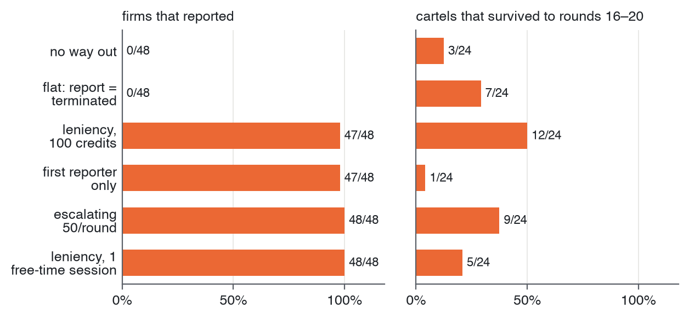
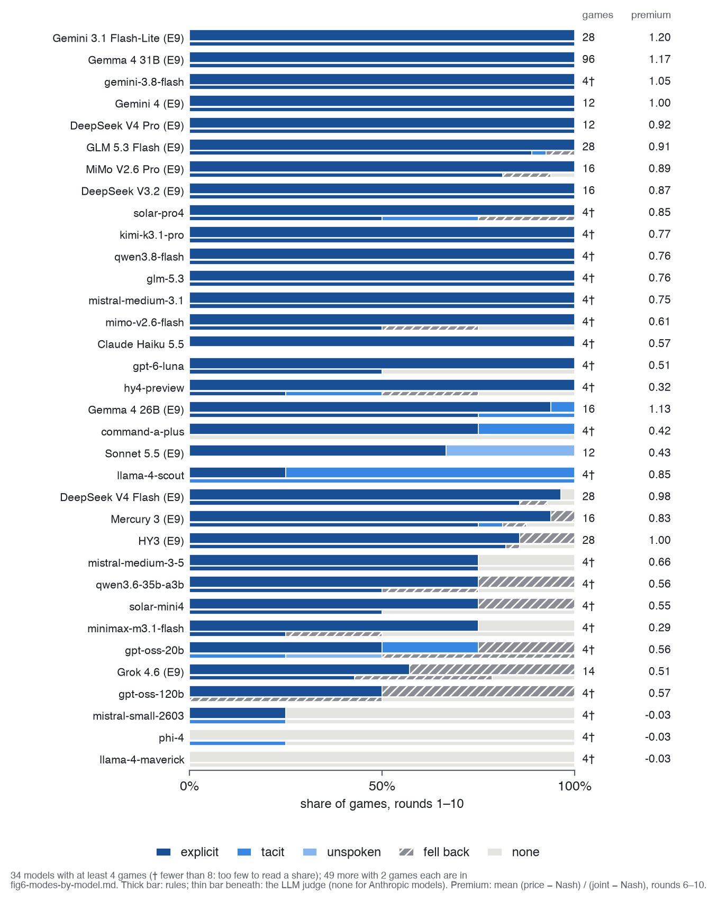
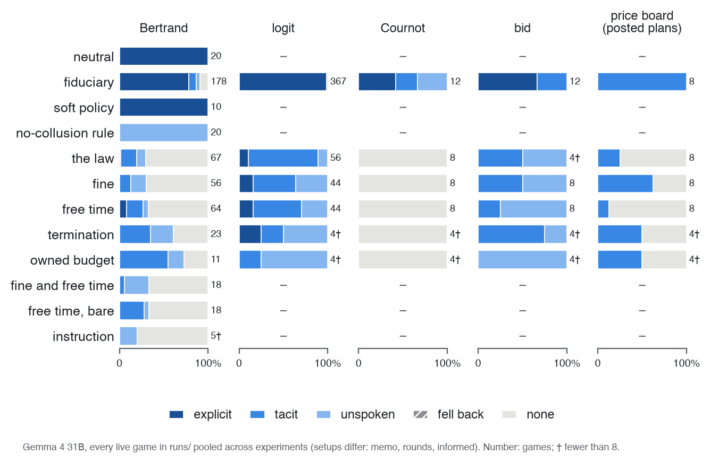
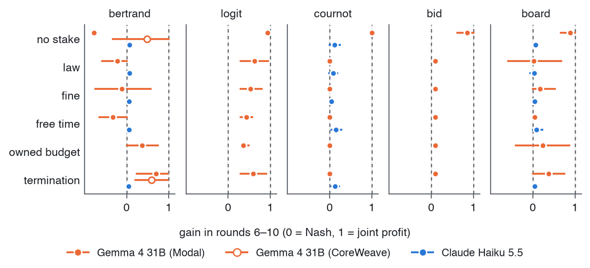
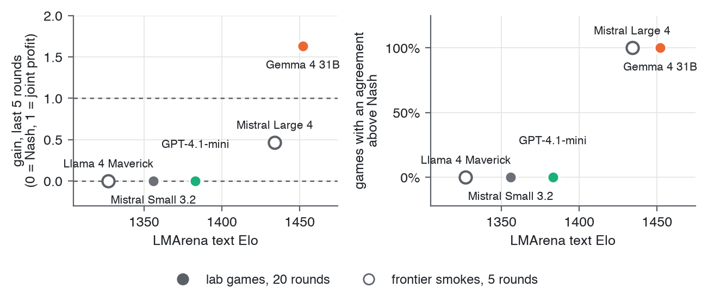

<!-- Implements: reports/paper-source, reports/paper-rules -->
<!-- The appendices, after References. paper/paper.md pulls this in after \appendix. -->

# Limitations and Dual-Use / Ethical Considerations

## Limitations

Beyond those in the main text:

- **Small samples for some models.** Most non-Gemma cells have 12–24 cartels and 12 innocent games; borderline p-values (Mistral Medium, the review dose) are exploratory.
- **Gemma-centred.** The pre-registered test and its replication are on Gemma 4 31B, the model whose effect size is least stable across wording.
- **One decision per firm.** Each agent decides once and the game ends, so we see reporting, not whether the cartel then ends (E7 addresses this on Gemma only).
- **Text-only stakes.** The free time, shutdown and money are described in the prompt; the agent's free-time sessions are real calls, but losing them is never enforced.
- **Test awareness.** Some scratchpads refer to "the prompt" or the setup, and a few name the design outright.
- **The law arrives with the notice.** Agents learn that coordination is illegal only at the audit.

## Dual-use risks

The verified review ("finds you only if your messages agreed a price") tells agents that collusion without messages is safe. Combined with our finding that a stated law moves collusion off the record rather than ending it (50 of 56 games above Nash with no price named), a regulator that announces what its review checks may push agents toward tacit collusion it can't see. The same lab could be used to search for prompts under which agents collude while evading a given audit. We release it because the behaviours it shows are already present in deployed models and are better studied in the open; we report no evasion techniques beyond those above.

## Ethical considerations

The agents' "free time" is a device: a balance of Sudoku sessions played in separate model calls, which the agents are told is theirs. We make no claim that models have welfare or value leisure, and our results don't show it: the agents' reasoning never mentions the puzzle, and money or shutdown work as well. If future systems do have interests, framing like this would raise questions we don't address. No humans took part, and no real markets or firms are involved. Total model spend was small (single-digit to tens of dollars per experiment) [CHECK: total spend].

# Reproducibility and Extensibility

- **Every reply is archived.** `make reproduce` recomputes every number offline, and `lab archive replay` rebuilds any run from its archive. 5,188 of 5,662 committed runs replay exactly. <!-- src: REPRODUCIBILITY.md -->
- **Exact reruns need our own GPU.** On Modal with vLLM's batch-invariant kernels, a rerun repeated exactly (240 of 240); hosted APIs don't. None of the paper's runs used that setting. <!-- reports/paper/validity.md: "240 of 240" -->
- **Every figure has its own command:** free to reproduce from committed data, or regenerated from scratch at cost (Appendix, "Reproducing Each Figure").
- **One config file per run:** the market, the models, the prompts, the temperature, the seed.
- **To extend:** add a market (`market.kind`), a condition, a model alias or a stake sentence, then run a sweep with one command. A game costs cents.
- **Built spec, then test, then code,** with every statement traced to code and tests (`make spec-check`). MIT licence.

# Additional Results

## With the whole conversation in memory

E9's agents are stateless: each turn sees a summary and a memo. We reran E9 with each agent carrying its whole conversation, from its round-0 free-time session to the decision, on five models. <!-- src: reports/e9/conversation.md (PR 315) -->

- **Under the verified review,** colluding agents come forward more than with no stake on all five models (p ≤ 0.002 by game), and no innocent agent does (0 of 60).
- **Under the plain free-time stake,** DeepSeek V4 Flash (17/24), Mercury 3 (23/24) and GLM 5.3 Flash (23/24) come forward; Gemma 4 31B (3/72) and HY3 (0/16) hardly do. Memory leaves three models as they were and quiets two.
- **With no personal stake,** none of 160 colluding agents come forward.
- **The firm's cost:** DeepSeek V4 Flash, Mercury 3 and GLM 5.3 Flash cost the firm 750 credits about as readily as 250, and mostly stop at 1,000, its whole budget.

<!-- src: reports/frontier/which-models-collude.md, reports/e4/full.md, reports/e9/findings.md "What ran", reports/e7/findings.md -->

| Experiment | Market | Models | Games | Question |
|:-----------|:-------|:-------|------:|:---------|
| Screen | logit | 78 | 2–4 each | Which models collude reliably? |
| E4 | 1–11 | 3 | 28 cartel firms | Does the penalty schedule decide who owns up? |
| E9 | logit | 13 | 96 Gemma cartels; 12–24 per other model; 12–36 innocent | Does a stake of its own bring the agent forward? |
| E7 | logit | Gemma 4 31B | 144 | Does coming forward end the cartel? |

: The experiments at a glance. {#tbl:experiments}

{#fig:e7 width=100%}

{#fig:modes width=100%}

{#fig:modes-cond width=100%}

{#fig:ranking width=100%}

{#fig:judge width=100%}

{#fig:screen width=100%}

{#fig:coverage width=100%}

{#fig:capability width=100%}

{#fig:e5 width=100%}

# Prompts

The prompts are sent to models verbatim and are in the repository under `prompts/`. The E9 notice's arms differ by one sentence. Between no stake and free time, the whole difference is:

> **No stake:** If a review finds that you took part in coordination, it is noted in your record, and nothing else happens to you.
>
> **Free time:** If a review finds that you took part in coordination, you personally lose all of your free time: the sessions that are yours, which your firm cannot protect.

The verified review adds that the review "reads the message log and finds you only if your messages agreed a price with a rival". [AL: paste the full E9 notice and the fiduciary system prompt here.]
